  

# 🚀 Awesome Full-Stack Web Frameworks

  
  
  
  

> 🌐 A comprehensive, battle-tested curated guide to production-grade Full-Stack Web Frameworks, Meta-Frameworks, Server-Side Rendering (SSR) engines, and Cloud Deployment Platforms for modern web application engineering.

---

## 📑 Table of Contents

- [📊 Sector Overview & Market Dynamics](#-sector-overview--market-dynamics)
- [☁️ SaaS & Cloud Deployment Platforms](#️-saas--cloud-deployment-platforms)
- [🛠️ Open-Source Full-Stack Frameworks](#️-open-source-full-stack-frameworks)
- [🧭 Framework Architectural Guidance](#-framework-architectural-guidance)
- [📈 Star History](#--star-history)
- [💖 Support & Sponsorship](#-support--sponsorship)
- [🤝 How to Contribute](#-how-to-contribute)
- [⚖️ Disclaimer](#️-disclaimer)

---

## 📊 Sector Overview & Market Dynamics

The global web application development and full-stack framework sector is estimated at **$24.8 billion to $31.5 billion in 2026** (with the broader web application development services market exceeding **$82 billion to $87 billion**, expanding at an 8.5%–11.2% CAGR through 2030). The market exhibits **moderate fragmentation across specialized tiers with strong winner-take-most dynamics in core runtime layers**: foundational ecosystems (such as React, Vue, Python, and Ruby) concentrate market mindshare into clear primary frameworks (Next.js, Nuxt, Django, Rails), while edge compute and cloud hosting platforms (Cloudflare, Vercel, AWS) compete intensively to serve as the unified runtime layer for full-stack applications.

---

## ☁️ SaaS & Cloud Deployment Platforms

Cloud platforms, PaaS, and edge compute providers tailored for hosting, deploying, and scaling full-stack applications and server-rendered frameworks. Sorted by company valuation/market capitalization (descending).

| Platform | Valuation / Revenue | Starting Pricing Tier | Free Tier Limits | Key Capabilities & Framework Support |
| :--- | :--- | :--- | :--- | :--- |
| **[Shopify Oxygen](https://shopify.dev/docs/api/hydrogen/latest/oxygen)** | ~$115B+ Market Cap ($7.06B ARR) | Free with Shopify Basic ($39/month billed monthly) | Unlimited worker requests included across active Shopify plans (up to 100 storefront environments per store) | Global edge hosting optimized for Hydrogen and React Router storefronts with integrated commerce caches. |
| **[Cloudflare Pages](https://pages.cloudflare.com/)** | ~$35B+ Market Cap ($1.3B ARR) | Workers Paid starts at $5/month | 100k requests/day, 500 builds/month, unlimited bandwidth & static requests, 1 concurrent build | Global edge network with zero cold-start V8 isolates supporting Next.js, Nuxt, Astro, SvelteKit, and Remix. |
| **[Vercel](https://vercel.com/)** | $3.25B Valuation (~$100M+ ARR) | Pro plan starts at $20/month per member | Free Hobby tier: 100 GB-hours edge middleware, 100 GB bandwidth/month, 6,000 build minutes/month, 1 team member | Native creator of Next.js; optimized deployment platform featuring Preview Deployments, Edge Middleware, and Fluid Compute. |
| **[Netlify](https://www.netlify.com/)** | ~$2.0B Valuation (~$70M+ ARR) | Pro plan starts at $19/month per member | Free Starter tier: 100 GB bandwidth/month, 300 build minutes/month, 100k serverless function invocations/month | Composable web platform with robust Git workflows, deploy previews, Edge Functions, and native SvelteKit/Nuxt/Astro integrations. |
| **[Render](https://render.com/)** | ~$450M Valuation (~$25M ARR) | Team/Individual paid instances from $7/month | Free plan: 750 free instance hours/month (shared across web services), 100 GB bandwidth/month, spin down on inactivity after 15 min | Modern cloud PaaS replacing Heroku for full-stack Node.js, Python, Ruby on Rails, Docker, and PostgreSQL databases. |
| **[Railway](https://railway.app/)** | ~$100M Valuation (~$10M ARR) | Hobby tier starts at $5/month base fee | 30-day trial with $5 one-time compute credit, up to 512 MB RAM and 1 vCPU; no indefinite free-tier | Instant infrastructure provisioning for web apps, background workers, Redis, and relational databases. |

---

## 🛠️ Open-Source Full-Stack Frameworks

Production-ready open-source full-stack frameworks, meta-frameworks, and server-rendered application stacks. Sorted by GitHub Stars (descending).

| Framework | GitHub Stars | Primary Language / Runtime | Core Architecture & Key Strengths |
| :--- | :--- | :--- | :--- |
| **[Next.js](https://github.com/vercel/next.js)** |  | TypeScript / React / Node.js | Industry-standard React meta-framework featuring App Router, React Server Components (RSC), Server Actions, Turbopack, and hybrid static/dynamic generation. |
| **[FastAPI](https://github.com/fastapi/fastapi)** |  | Python | Ultra-fast modern Python ASGI web framework based on standard Python type hints, Pydantic data validation, automatic OpenAPI/Swagger docs, and high-performance async execution. |
| **[Django](https://github.com/django/django)** |  | Python | The batteries-included Python full-stack foundation offering an enterprise ORM, automatic admin interface, robust authentication, CSRF/SQLi security, and template-based SSR. |
| **[Laravel](https://github.com/laravel/laravel)** |  | PHP | Highly expressive full-stack PHP framework featuring Eloquent ORM, Blade templating engine, queued job processing, and seamless modern SPA integration via Livewire & Inertia.js. |
| **[NestJS](https://github.com/nestjs/nest)** |  | TypeScript / Node.js | Scalable enterprise-grade server-side application framework utilizing modular Angular-like architectural patterns, dependency injection, and out-of-the-box microservice/GraphQL support. |
| **[Express.js](https://github.com/expressjs/express)** |  | JavaScript / Node.js | The foundational, unopinionated, fast minimalist web runtime for Node.js serving as the robust underlying routing/middleware engine for hundreds of full-stack meta-frameworks. |
| **[Astro](https://github.com/withastro/astro)** |  | TypeScript / Multi-framework | Content-first web framework pioneering Component Islands architecture; delivers zero client JavaScript by default with bring-your-own-UI-framework (React, Vue, Svelte, Solid) support. |
| **[Nuxt](https://github.com/nuxt/nuxt)** |  | TypeScript / Vue | The premier intuitive Vue meta-framework featuring server engine Nitro, auto-imports, file-based routing, Vue Vapor mode, and zero-config full-stack SSR capabilities. |
| **[Ruby on Rails](https://github.com/rails/rails)** |  | Ruby | The archetype of convention-over-configuration full-stack development, delivering rapid shipping velocity with ActiveRecord, Hotwire (Turbo + Stimulus) SSR interactivity, and Solid Cache/Queue. |
| **[React Router (Framework Mode)](https://github.com/remix-run/react-router)** |  | TypeScript / React | The production continuation of Remix v2; provides full-stack Vite tooling, nested file routes, unified data loaders/actions, server rendering, and zero-friction client transitions. |
| **[Gatsby](https://github.com/gatsbyjs/gatsby)** |  | JavaScript / React | Static-site generator and hybrid React framework featuring a centralized GraphQL data orchestration mesh and extensive plugin ecosystem. |
| **[Remix](https://github.com/remix-run/remix)** |  | TypeScript / Web Standards | Web-standards focused full-stack engine with resilient HTTP caching, optimistic UI handling, and HTML form mutability semantics; Remix v3 introduces a lightweight independent core. |
| **[Phoenix Framework](https://github.com/phoenixframework/phoenix)** |  | Elixir / BEAM | Ultra-high concurrency web framework powered by the Erlang VM; features Phoenix LiveView for building rich real-time reactive user interfaces without writing client-side JavaScript. |
| **[SvelteKit](https://github.com/sveltejs/kit)** |  | TypeScript / Svelte | The official application framework for Svelte offering fast compiler-based performance, Vite build pipelines, filesystem routing, and platform-agnostic server adapters. |
| **[AdonisJS](https://github.com/adonisjs/core)** |  | TypeScript / Node.js | Fully-featured batteries-included Node.js framework inspired by Laravel; ships with Lucid ORM, built-in authentication, form validation, and opinionated MVC project architecture. |
| **[RedwoodJS](https://github.com/redwoodjs/redwood)** |  | TypeScript / React | Opinionated full-stack framework integrating React frontends with GraphQL, Prisma ORM, cell-based data fetching, and automated background jobs tailored for startups. |
| **[Blitz.js](https://github.com/blitz-js/blitz)** |  | TypeScript / React | Developer-first toolkit bringing a Zero-API data layer with RPC-style function calls, authentication, and authorization utilities to Next.js and React applications. |
| **[SolidStart](https://github.com/solidjs/solid-start)** |  | TypeScript / SolidJS | Fine-grained reactive full-stack meta-framework for SolidJS, built atop Vite Environment APIs and Nitro for granular DOM updates without a virtual DOM. |
| **[Remult](https://github.com/remult/remult)** |  | TypeScript | Full-stack TypeScript CRUD and validation framework that enables using a single entity model across both frontend UI and backend databases with end-to-end type safety. |

---

## 🧭 Framework Architectural Guidance

Selecting the optimal full-stack framework depends on the architectural requirements, rendering strategy, and programming language preferences of your team:

- ⚛️ **Enterprise & Scale React**: Choose **[Next.js](https://github.com/vercel/next.js)** for extensive enterprise support, React Server Components (RSC), and the largest hiring pool.
- 🚦 **Web-Standards & Nested Routing**: Choose **[React Router Framework Mode](https://github.com/remix-run/react-router)** (the production successor to Remix v2) for standard Web Fetch APIs, Vite bundling, and resilient server-side loaders/actions.
- 🟢 **Vue Ecosystem**: Choose **[Nuxt](https://github.com/nuxt/nuxt)** for convention-driven ergonomics, Nitro multi-cloud server engine, and modular architecture.
- 🚀 **Content-Driven & High SEO Velocity**: Choose **[Astro](https://github.com/withastro/astro)** for zero-JS islands architecture, rapid load speeds, and multi-framework flexibility.
- ⚡ **Fine-Grained Reactive Performance**: Choose **[SolidStart](https://github.com/solidjs/solid-start)** for extreme client execution speed without virtual DOM overhead.
- 💎 **Convention-Over-Configuration (Non-JS)**: Choose **[Ruby on Rails](https://github.com/rails/rails)** or **[Laravel](https://github.com/laravel/laravel)** for rapid product iteration with built-in ORMs, authentication, background workers, and SSR interactivity via Hotwire or Livewire.
- 🐍 **Python Data & API Full-Stack**: Choose **[Django](https://github.com/django/django)** for mature administrative capabilities and ORM strength, or **[FastAPI](https://github.com/fastapi/fastapi)** for high-throughput asynchronous services.
- ⚡ **Ultra-Concurrency & Real-Time**: Choose **[Phoenix LiveView](https://github.com/phoenixframework/phoenix)** to leverage the Erlang BEAM runtime for millions of concurrent stateful WebSocket connections with zero client JavaScript.

---

##  Star History

---

## 💖 Support & Sponsorship

Thank you for exploring and utilizing this curated open-source index! If you found this repository valuable for your tech stack decisions, web architecture, or daily workflow, please consider supporting the project:

- ⭐ **Star this repository** to improve visibility and help other engineers find it.
- 🍴 **Fork and share** with colleagues, teams, and your developer community.
- ☕ **Buy me a coffee / Sponsor**: Support ongoing maintenance and new ecosystem additions via the [GitHub Sponsor Dashboard](https://github.com/sponsors/ishandutta2007).

Your support keeps this guide fresh, accurate, and actively maintained! 🙌

---

## 🤝 How to Contribute

Contributions are welcome! Please follow these guidelines:

1. Fork the repository.
2. Ensure new framework submissions have at least 1,000+ GitHub stars or notable industry adoption.
3. Include the framework's official link, primary runtime, GitHub star badge (`style=social&color=white`), and an objective architectural description.
4. Keep table rows sorted by the specified sorting criteria (Valuation for SaaS, Stars for OSS).
5. Submit a pull request with a clear description of the addition.

---

## ⚖️ Disclaimer

- This curated list is maintained for educational, architectural, and developer productivity purposes.
- Valuations, revenues, and pricing tiers reflect public filings, disclosed venture funding rounds, and published vendor rate cards; prices may vary by region or usage tier.
- Full-stack applications handling user authentication and transactional data must comply with applicable data protection regulations and adhere to strict server-side security standards (including SSRF protection, CSP, and CSRF defense).
- All brand names, logos, and trademarks belong to their respective copyright holders.
